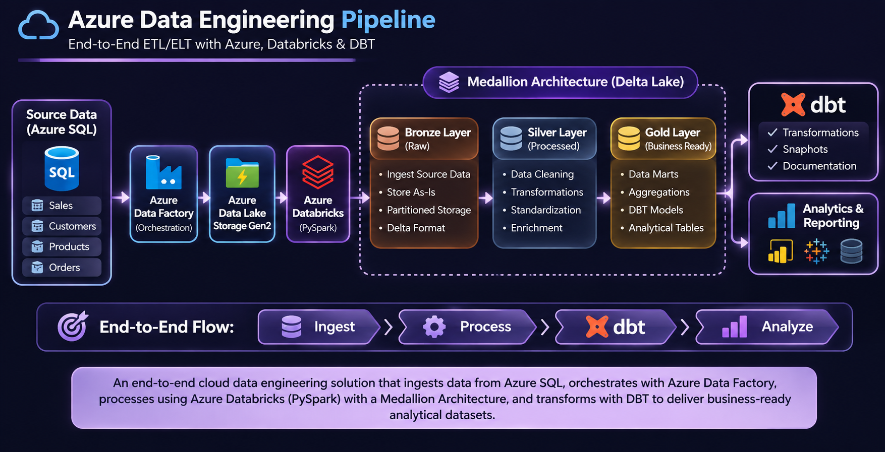
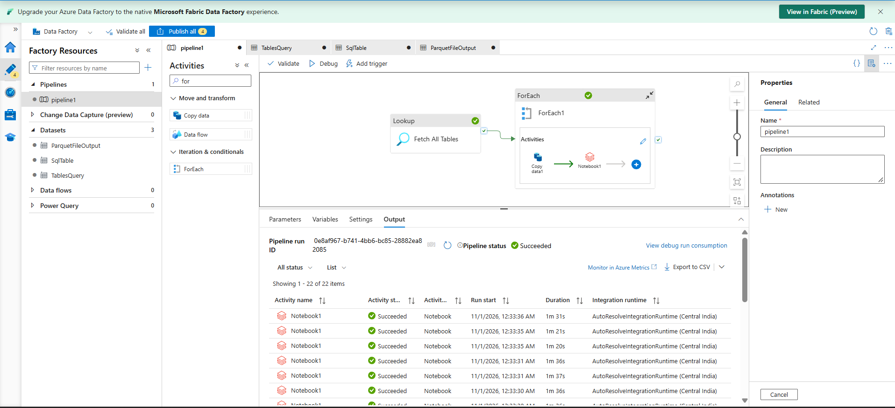
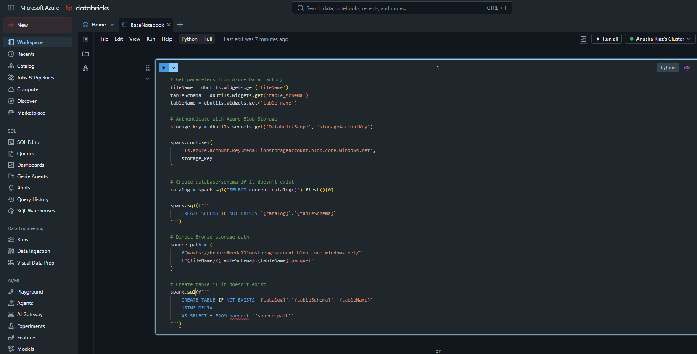
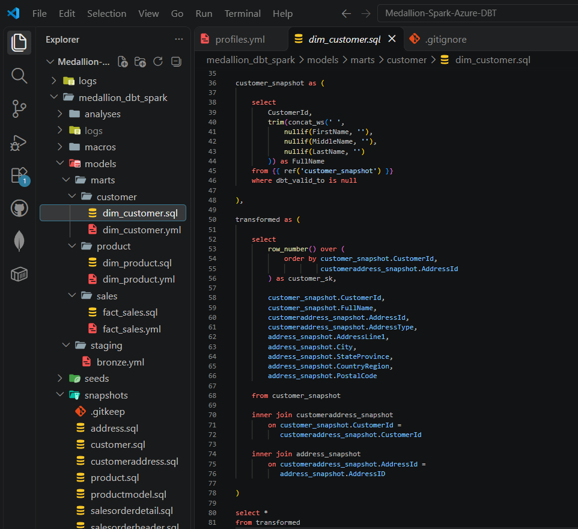
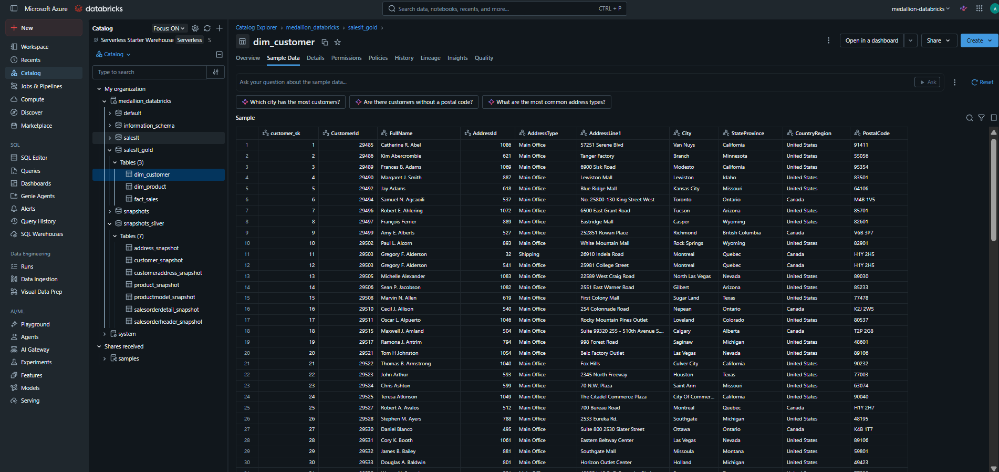

# End-to-End Azure Data Engineering Pipeline | Azure Data Factory, Databricks & DBT

<p align="center">
  <strong>Cloud Data Engineering | Medallion Architecture | ETL/ELT | Data Transformation</strong>
</p>

<p align="center">
  
  
  
  
  
</p>

## Project Overview

An end-to-end **Azure Cloud Data Engineering Pipeline** developed using Microsoft Azure services, Azure Databricks, Apache Spark, and DBT.

The project focuses on building a structured data processing solution that ingests business data from Azure SQL Database, integrates cloud storage and processing services, and transforms data through a Medallion Architecture.

It demonstrates the implementation of cloud-based ETL/ELT workflows, data transformation, pipeline orchestration, historical data tracking, and analytical data preparation.

## Business Scenario

The project addresses the need to build a cloud-based data platform that can process and organize business data for downstream analytics.

The solution demonstrates how data from a relational database can be integrated with Azure cloud services and transformed into structured datasets through multiple processing layers.

Key engineering requirements include:

- Ingesting source data from Azure SQL Database.
- Storing and organizing data using Azure Data Lake Storage Gen2.
- Processing and transforming datasets with Azure Databricks and Apache Spark.
- Implementing Bronze, Silver, and Gold data layers.
- Orchestrating pipeline workflows using Azure Data Factory.
- Applying DBT transformations and snapshots for data modeling and historical tracking.
- Preparing analytical data marts and generating DBT documentation.

## Architecture

The solution follows the **Medallion Architecture**, organizing data processing into three logical layers.

| Layer | Purpose | Implementation |
|---|---|---|
| **Bronze** | Raw data ingestion | Initial source data ingestion and storage |
| **Silver** | Data cleaning and transformation | Structured processing and data refinement |
| **Gold** | Analytical data preparation | Business-oriented datasets and data marts |


### Data Pipeline Workflow

The architecture below illustrates the integration of Azure SQL, Azure Data Factory, ADLS Gen2, Azure Databricks, and DBT to build an end-to-end cloud data engineering solution.

<p align="center">
  
</p>


## Technology Stack

| Category | Technologies |
|---|---|
| **Cloud Platform** | Microsoft Azure |
| **Data Ingestion & Orchestration** | Azure Data Factory |
| **Cloud Storage** | Azure Data Lake Storage Gen2 |
| **Source Database** | Azure SQL Database |
| **Data Processing** | Azure Databricks, Apache Spark, PySpark |
| **Data Transformation** | DBT, SQL |
| **Data Architecture** | Medallion Architecture, Delta Lake |
| **Security & Secrets** | Azure Key Vault, Databricks Secret Scope |
| **Data Governance** | Unity Catalog |
| **Programming Languages** | Python, SQL |

## Project Structure

The repository is organized into logical sections for environment setup, data ingestion, transformation, orchestration, and SQL implementations.

```text
Azure-Data-Engineering-Pipeline/
│
├── setup/
│   ├── environment_setup
│   ├── storage_configuration
│   └── catalog_setup
│
├── notebooks/
│   ├── bronze_layer
│   ├── silver_layer
│   └── gold_layer
│
├── data_processing/
│   ├── data_cleaning
│   ├── transformations
│   └── data_modeling
│
├── dbt_project/
│   ├── models/
│   ├── snapshots/
│   ├── tests/
│   └── dbt_project.yml
│
├── sql/
│
├── adf/
│
└── README.md
```

*Note: This is a suggested logical structure. Adjust the directory and notebook names to match the actual files in your repository.*

## Key Engineering Implementations

### 1. Azure Environment & Storage Configuration

- Configured the Azure cloud environment and required data engineering resources.
- Integrated Azure SQL Database with the cloud data processing workflow.
- Configured Azure Data Lake Storage Gen2 for data storage.
- Worked with Azure Databricks and Unity Catalog for data organization and access management.
- Configured Azure Key Vault and Databricks Secret Scope for secure credential handling.

### 2. Data Ingestion & Integration

- Used Azure SQL Database as the source for business data.
- Integrated Azure Data Factory into the data ingestion workflow.
- Connected Azure Data Factory with Azure Databricks for data processing orchestration.
- Organized the ingestion workflow around the Medallion Architecture.

### Azure Data Factory Pipeline Execution

The Azure Data Factory pipeline orchestrates the ingestion workflow, including table discovery, iteration, data copy activities, and Databricks notebook execution. The captured run shows a successful pipeline execution.

<p align="center">
  
</p>


### 3. Medallion Architecture & Data Processing

- Implemented Bronze, Silver, and Gold processing layers.
- Used Azure Databricks and Apache Spark for data processing and transformation.
- Applied data cleaning and transformation logic to prepare structured datasets.
- Organized processed data for downstream analytical workloads.

### Databricks Data Processing Implementation

The following notebook demonstrates parameterized data processing, secure secret retrieval, Azure Storage access configuration, and table creation using Spark SQL.

<p align="center">
  
</p>

### 4. DBT Transformations & Snapshots

- Configured DBT to work with the Databricks data platform.
- Developed DBT models for structured data transformation.
- Implemented DBT snapshots to support historical data tracking.
- Organized transformation logic into reusable models.
- Generated DBT documentation to describe the project models and data sources.

### DBT Model Implementation

Implemented DBT models to combine customer, address, and snapshot data into structured analytical datasets using SQL transformations and joins.

<p align="center">
  
</p>

### 5. Data Marts & Analytical Preparation

- Developed analytical data marts using transformed datasets.
- Organized business-oriented data models for downstream reporting and analysis.
- Used SQL transformations to prepare structured analytical outputs.

### Gold-Layer Analytical Tables

The Databricks catalog contains the processed Gold-layer customer table, demonstrating the availability of structured analytical data with customer and address attributes.

<p align="center">
  
</p>

## Execution Workflow

The project can be explored through the following logical sequence:

1. **Azure Setup:** Configure the required Azure resources and environment.
2. **Storage Configuration:** Prepare Azure Data Lake Storage Gen2 and the required access configuration.
3. **Source Integration:** Connect Azure SQL Database to the data engineering workflow.
4. **Pipeline Orchestration:** Configure Azure Data Factory and Databricks integration.
5. **Data Processing:** Execute Bronze, Silver, and Gold processing workflows.
6. **DBT Configuration:** Configure the DBT project and validate the Databricks connection.
7. **Transformations:** Execute DBT models and snapshots.
8. **Documentation:** Generate DBT documentation and review the resulting data models.

## How to Explore the Project

The project contains exported notebooks, SQL scripts, and DBT implementation files.

You can explore the implementation using:

- **GitHub:** Browse the project notebooks, SQL scripts, and DBT files.
- **VS Code:** Review exported notebooks and project code.
- **Jupyter Notebook:** Open and inspect notebook implementations.
- **Databricks:** Execute Spark notebooks and explore catalog objects.
- **DBT:** Review transformation models, snapshots, and generated documentation.

To execute the complete workflow, you will need an appropriately configured Azure environment, access to the required Azure resources, and the necessary credentials and permissions.

## Key Concepts Demonstrated

- Azure Cloud Data Engineering
- Azure Data Factory Orchestration
- Azure Data Lake Storage Gen2
- Azure Databricks
- Apache Spark and PySpark
- Medallion Architecture
- Delta Lake
- ETL/ELT Pipelines
- DBT Models and Snapshots
- Historical Data Tracking
- Data Warehousing and Data Marts
- Unity Catalog
- Cloud Security and Secret Management

## Future Enhancements

Potential extensions to the project include:

- Implementing automated pipeline scheduling and monitoring.
- Adding comprehensive data quality checks and validation.
- Improving pipeline error handling and recovery.
- Expanding incremental data processing capabilities.
- Developing additional analytical models and reporting workflows.

## Author

**Amash Riaz**

Computer Science Graduate | Aspiring Data Engineer

- **GitHub:** [Amashriaz1103](https://github.com/Amashriaz1103)
- **LinkedIn:** [Amash Riaz](https://www.linkedin.com/in/amash-riaz/)

---

<p align="center">
  <strong>Built to demonstrate practical Cloud Data Engineering skills using Microsoft Azure, Databricks, Apache Spark, and DBT.</strong>
</p>
